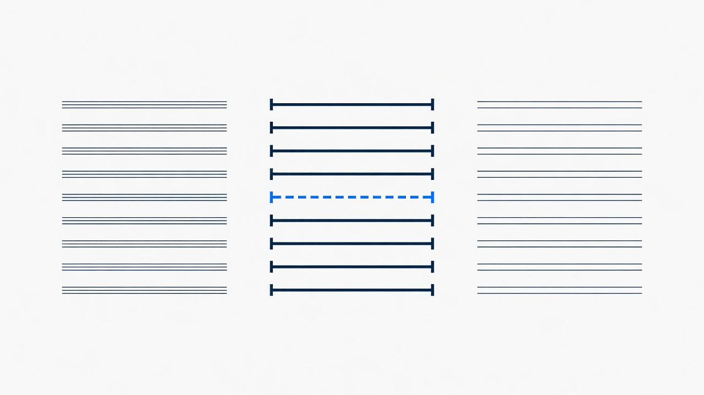
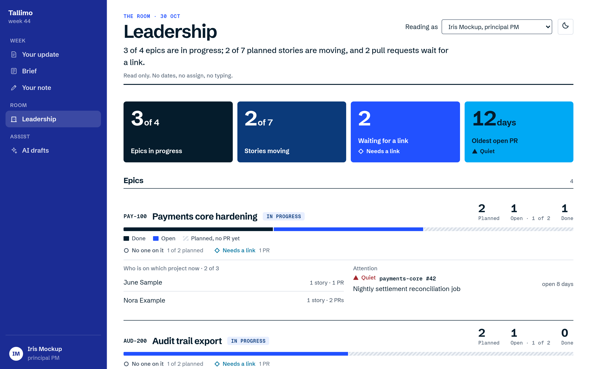
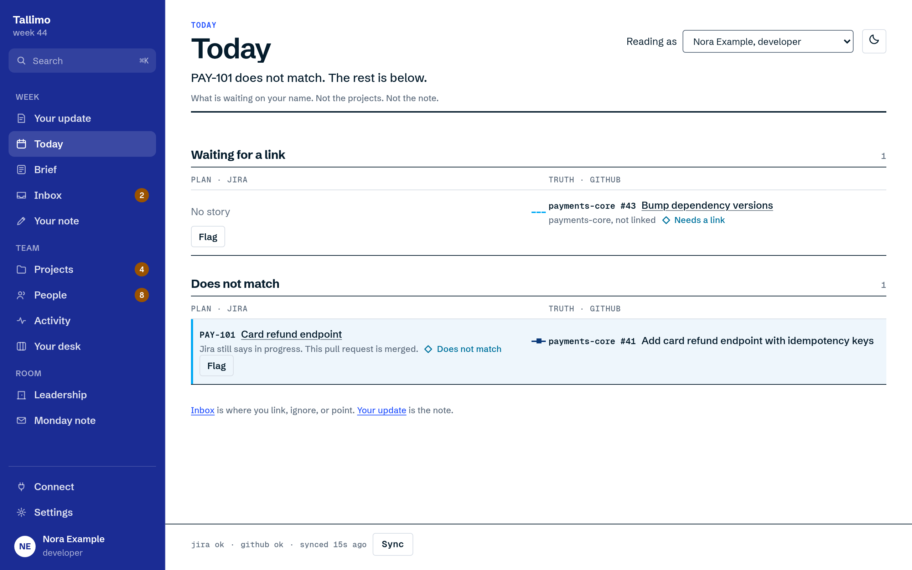
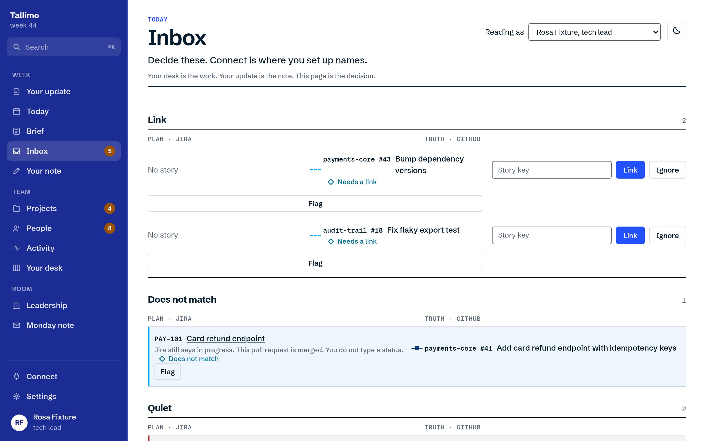
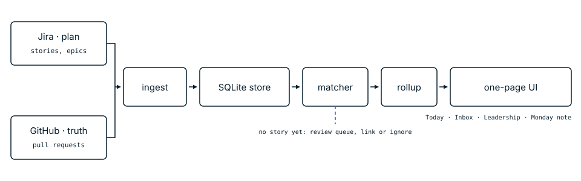

# Tallimo

**Status: Finished. No longer developed.**

Jira is the plan. GitHub is the truth. Tallimo matches them, so you copy the status note instead of writing it.

<picture>
  <source media="(prefers-color-scheme: dark)" srcset="docs/readme/hero-dark.png">
  
</picture>

## Why it exists

Teams keep the plan in Jira and the work in GitHub pull requests. The two drift.

A pull request can have no story. A story can have nobody on it. A pull request can sit quiet.

Someone then writes the Monday status note by hand.

Tallimo matches each pull request to a story, so that note comes from the match.

## Screenshots

### Leadership

<picture>
  <source media="(prefers-color-scheme: dark)" srcset="docs/readme/leadership-dark.png">
  
</picture>

Read-only page with key numbers, epics, and the note.

### Today

<picture>
  <source media="(prefers-color-scheme: dark)" srcset="docs/readme/today-dark.png">
  
</picture>

Where a developer or a PM lands.

### Inbox

<picture>
  <source media="(prefers-color-scheme: dark)" srcset="docs/readme/inbox-dark.png">
  
</picture>

Where a tech lead lands.

Screens show the Signal Consult design, with the fictional sample people.

## Quick start

Rust stable, via rustup. Tested on macOS.

```bash
git clone <repository-url> tallimo
cd tallimo/crates
cargo test --locked
cargo run -p rollup-api
```

The page helper tests need Node 18 or newer. From the repo root:

```bash
node --test ui/helpers.test.mjs
```

rollup-api prints the access link when it starts. It does not open a browser: copy the link from the startup line that says it is running into your browser, then pick a person. The link is printed only to a terminal. When the output goes to a log, that line names the token file instead, so build the link yourself: `http://127.0.0.1:8787/#t=` followed by the contents of that file (`cat rollup.db.token`).

Reload the sample data with `curl -X POST http://127.0.0.1:8787/sync -H "X-Tallimo-Token: $(cat rollup.db.token)"`. The token file sits next to the database (`rollup.db.token` for `rollup.db`) and is readable only by your user. The page sends that token, taken from the #t= link, on every request.

To run a second copy on another port with a fresh database, for example next to one already on 8787: `TALLIMO_PORT=8788 ROLLUP_DB_PATH=/tmp/tallimo-fresh.db cargo run -p rollup-api`, then open the link it prints and post to `/sync` on that port once (with that copy's token). `TALLIMO_PORT` defaults to 8787. A value that is not a port from 1 to 65535 stops the server at startup with an error that names it.

## Schedule the AI pass (macOS)

Optional. Print a launchd job and save it. It runs `ai-run --if-due` every 30 minutes from the directory that holds `.env` and the database:

```bash
rollup-api schedule print --dir /absolute/path/to/dir > ~/Library/LaunchAgents/local.tallimo.ai-run.plist
launchctl bootstrap gui/$(id -u) ~/Library/LaunchAgents/local.tallimo.ai-run.plist
```

The plist names that binary and that directory. It holds no secrets. Settings come from `.env` in that directory.

Stop it with `launchctl bootout gui/$(id -u)/local.tallimo.ai-run`. Remove it by deleting `~/Library/LaunchAgents/local.tallimo.ai-run.plist`.

`ROLLUP_AI=off` in `.env` pauses runs without unloading the job.

## Corrections from an MCP client

`tallimo-mcp` is a stdio MCP server. The app server must already be running. `TALLIMO_OWNER` is your Tallimo id, the same id you pick on the Who page. The tool reads the token file next to the database (`ROLLUP_DB_PATH`, or `rollup.db` in its working directory).

```bash
cd crates
cargo build -p tallimo-mcp --release
```

Register `<path>/target/release/tallimo-mcp` as a stdio server in your MCP client, with the environment variable `TALLIMO_OWNER=<your id>`.

`tallimo_today` shows the live draft and the last sent update. `tallimo_edit_item` changes one field on an item in the open draft.

### Upgrading from v0.1.0

A v0.1.0 database does not work with v0.2.0: Sync fails with a 500 and the old people stay in it. Stop the server, move `crates/rollup.db*` aside to a dated backup outside the repo, then start v0.2.0 and post to `/sync` once:

```bash
# from the repo root, with the server stopped
mkdir -p ~/tallimo-backups/rollup-YYYY-MM-DD
mv crates/rollup.db* ~/tallimo-backups/rollup-YYYY-MM-DD/
```

Never delete the old database. It may hold real data.

## What it does

- See planned, in flight, and done for each epic, without building the rollup by hand.
- Match each pull request to a story from the key in the branch or the title.
- Clear unmatched pull requests in a review queue, where you link or ignore them.
- See the gaps on the page: "Does not match", "No one on it", "Quiet" (open more than 5 days), and "Needs a link".
- Open the page for your role: developer and PM on Today, tech lead on Inbox, principal PM on Leadership (read only).
- Copy the weekly note (Monday note, Your update) from the matched data. It is never sent for you.

Pages: Who (pick a person), Today, Inbox, Your desk, Your update, People, Projects, Activity, Leadership, Monday note, Connect, and Settings. Connect is where you claim a Jira board, map a GitHub repo, and link pull requests.

## How it works



Ingest pulls Jira stories and epics, and GitHub pull requests, into a local SQLite store (`rusqlite`, file `rollup.db`, never committed).

The matcher links each pull request to a story by the key in the branch or the title. A review queue is there to link or ignore what did not match.

Rollup counts each epic as planned, in flight, or done. Crates: `rollup-core` (store, matcher, rollup, leadership), `rollup-ingest` (Jira and GitHub), `rollup-api` (axum) on http://127.0.0.1:8787, `tallimo-mcp` (stdio MCP tool for corrections).

The UI is one HTML file compiled into the binary (no build step, no npm). Look is the Signal design system, Consult edition: navy rail, blue key numbers, light and dark. This repo runs in fixture mode and reads `fixtures/sample.json` (fictional people and sample data only). Live sync exists in code and stays off (`ROLLUP_SYNC_MODE=fixture`).

## Status

Finished. No longer developed. There are no further releases, no security fixes, and no support. See [SECURITY.md](SECURITY.md).

## Contributing

Not accepting contributions. Fork it freely under the Apache-2.0 licence. See [CONTRIBUTING.md](CONTRIBUTING.md).

Use sample and fixture data only. Never commit real client data, exports, tokens, or a `.env`.

## Licence

[](https://www.apache.org/licenses/LICENSE-2.0)

Apache-2.0. See [LICENSE](LICENSE).

Relicensed from MIT to Apache-2.0 from this commit. Earlier releases remain under MIT. The prior MIT text is in [LICENSE-MIT-PRIOR](LICENSE-MIT-PRIOR).

## Credits

Fonts (in the redesign): Schibsted Grotesk and Geist Mono, SIL Open Font License.
